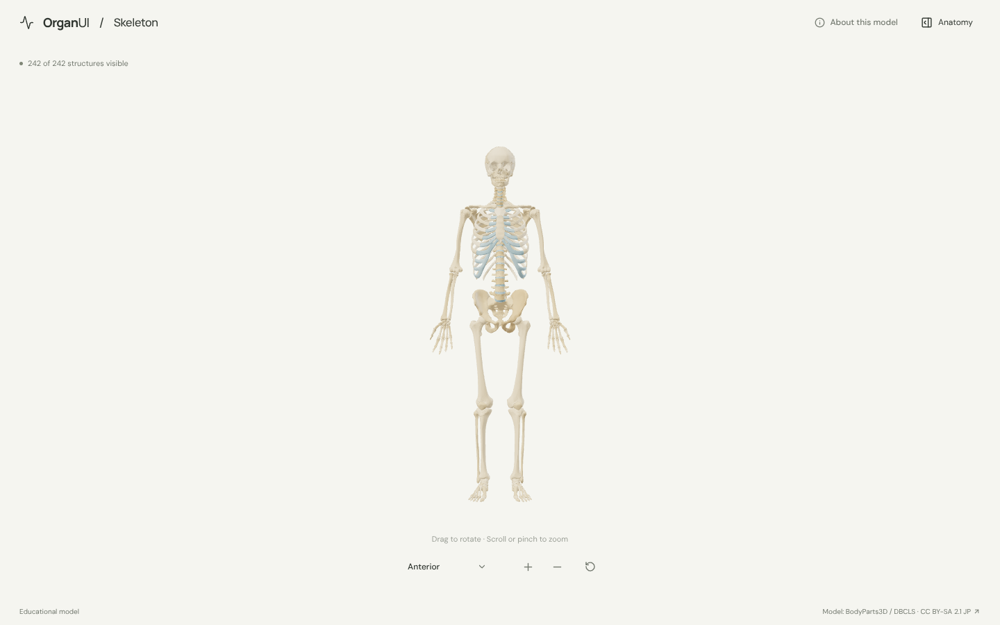
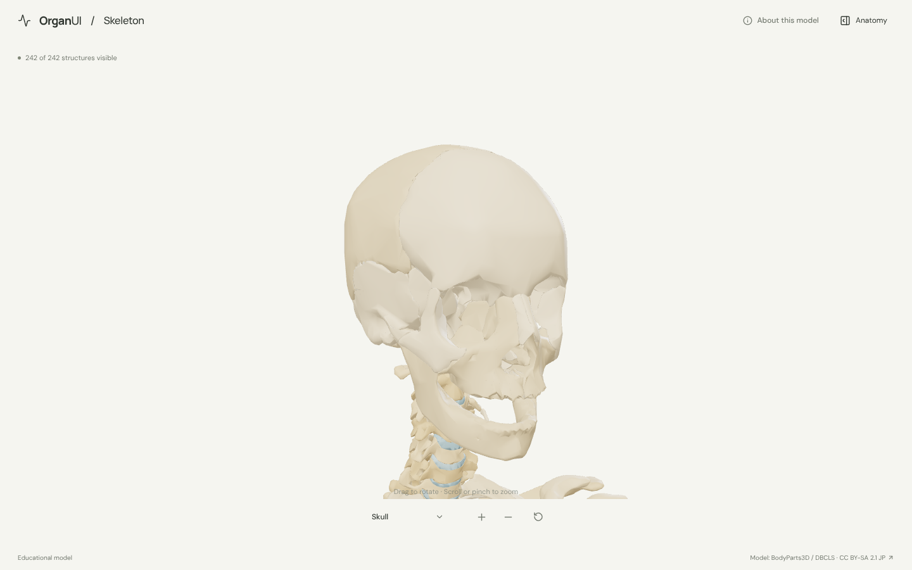
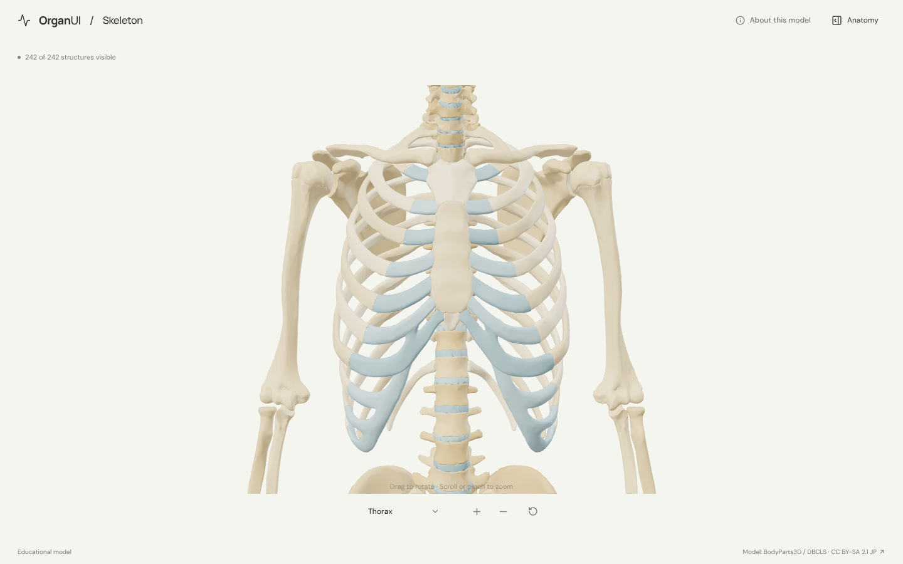
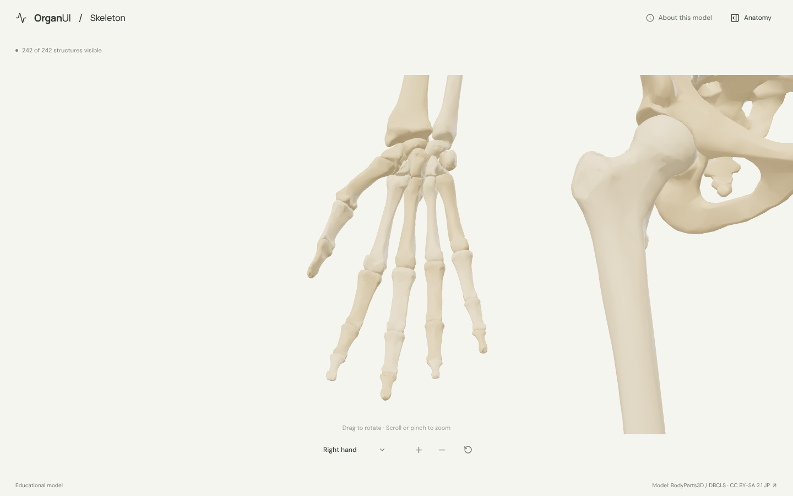
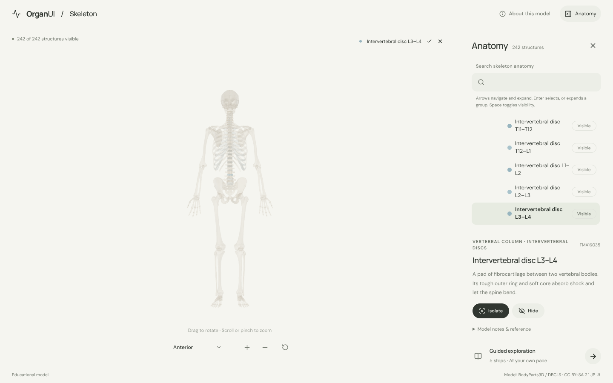
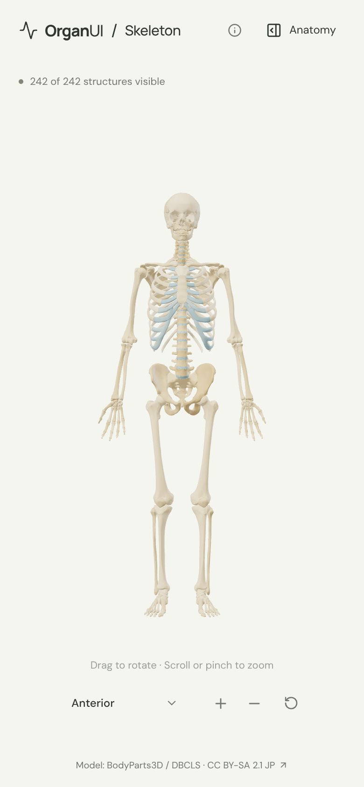
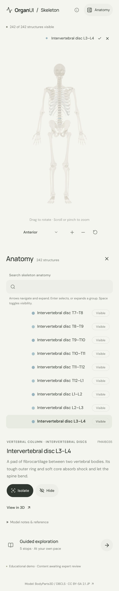

# OrganUI Skeleton

A minimal, standalone, open-source explorer of the whole human skeleton, built with React, TypeScript, Three.js, React Three Fiber, Vite, and Bun. It follows the [OrganUI Heart](https://github.com/organui/heart-3d) explorer's selection, framing, panel and toolbar behaviour.

**Status:** working local demo. 242 selectable structures (every bone of the skull, spine, thorax, pelvis and limbs in the source, plus costal cartilages and intervertebral discs), a real bundled model, regional camera views, responsive layouts, and checked desktop/mobile interactions. Public deployment and clinical anatomy review have not been completed.



## Run locally

Install [Bun](https://bun.sh/) **1.4.2 or newer**, then:

```sh
git clone https://github.com/organui/skeleton-3d.git
cd skeleton-3d
bun install --frozen-lockfile
bun run dev
```

Open **http://127.0.0.1:5173**. No environment variables, accounts, API keys, sibling repositories, model downloads, or external font services are needed to run the app after dependency installation. The ready-to-use 5.2 MB GLB is in `public/models/`.

```sh
bun run typecheck       # TypeScript checks, including conversion scripts
bun run test            # Unit tests for anatomy data, regional views, selection emphasis, picking, and the anatomy-tree adapter
bun run verify:model    # Check the GLB hash, source IDs, and valid geometry
bun run build           # Typecheck and create dist/
bun run preview         # Serve the production build at http://127.0.0.1:4173
bun run format:check    # Check formatting of application and preparation code
```

The app is static and uses relative build paths. `dist/` can be hosted on any static web server; do not open `index.html` directly with `file://`. No deployment has been performed.

## Explore

- The skeleton opens in the **anterior** view. Drag to rotate; scroll or pinch to zoom. Manual rotation changes the view label to **Custom view**.
- The view menu has three whole-body views (anterior, posterior, right lateral) and five regional views (**skull, thorax, spine, right hand, right foot**). Regional views frame just that region's bones so small bones such as the carpals fill the stage, and zoom from there.
- Open **Anatomy** from the header to browse the tree (the OrganUI registry `anatomy-tree` component). Bones are grouped by region, then by family (for example *Right upper limb › Carpal bones*). Selecting a bone in 3D or in the tree keeps it solid with a soft glow and ghosts everything else. The name chip above the canvas opens the panel; Escape closes it and returns focus to the toggle.
- Isolate a bone, hide it, or restore all. Region and family rows show or hide all their bones. **Reset explorer** restores the anterior camera, visibility, selection, tree search/expansion and tour state.
- Follow five guided stops: the whole skeleton, the skull, the rib cage, the vertebral column, and the hand.
- Focus the model and use arrow keys to rotate, `+`/`-` to zoom. All anatomy text is available without WebGL.

<details>
<summary>Regional views, anatomy panel and mobile screenshots</summary>













</details>

## Model, credits, and review status

> BodyParts3D, © The Database Center for Life Science licensed under CC Attribution-Share Alike 2.1 Japan.

The model is a curated, simplified subset of **BodyParts3D 3.0**, taken from the STL copy in [Kevin-Mattheus-Moerman/BodyParts3D](https://github.com/Kevin-Mattheus-Moerman/BodyParts3D) on **16 October 2026**. That copy carries **CC BY-SA 2.1 Japan**, so the adapted `skeleton.glb` is shared under the same license, separately from this repository's **MIT code license**. The heart, brain, liver and kidney explorers use BodyParts3D 4.0 from the official archive under CC BY 4.0; [model provenance](docs/MODEL_PROVENANCE.md) explains the difference.

Read [model provenance and preparation](docs/MODEL_PROVENANCE.md), [asset attribution](public/models/ATTRIBUTION.md), and the [checksum manifest](public/models/manifest.json). Fonts are bundled under the SIL Open Font License; [third-party notices](public/licenses/README.md) are included in the production output.

Names were checked against the source parts list and geometry was inspected. Descriptions summarize the [NCI SEER Training skeletal system pages](https://training.seer.cancer.gov/anatomy/skeletal/). **Expert anatomical review is pending.** This is an educational interface demonstration, not a diagnostic or measurement tool.

Known limitations:

- The coccyx, teeth and ear ossicles have no mesh in the source and are not shown. Each hip bone is one mesh, as are the sesamoid bones of each foot.
- Meshes are simplified for the web (2.1 million to about 277,000 triangles). Fine surface detail such as foramina edges is softened.
- Ligaments, joint capsules and articular cartilage are not modelled; costal cartilages and intervertebral discs are the only cartilage shown. Colors are illustrative.
- This is a single adult male reference model, not a complete or patient-specific anatomy.
- Browser checks used headless desktop Chromium and a mobile viewport, not physical devices or a screen-reader audit.

## Reproduce the model

The runtime asset is included. To rebuild it from verified upstream inputs:

```sh
bun run prepare:model
bun run verify:model
```

This downloads 243 pinned files (about 103 MB) into ignored `.asset-cache/`, verifies their SHA-256 hashes, and exports the GLB plus manifest. Conversion selects real meshes, welds STL vertices, simplifies each mesh in proportion to its size with meshoptimizer, transforms coordinates, recomputes normals and applies colors. It does not invent geometry, and the output is deterministic.

## Implementation

- `src/anatomy.ts`: source-ID mappings, explanatory text, named and regional views, and guided stops.
- `src/App.tsx`: selection/visibility state and accessible interface controls.
- `src/components/ui/anatomy-tree.tsx`: OrganUI registry component installed with the shadcn CLI; tracked unmodified ([registry integration](docs/REGISTRY_INTEGRATION.md)).
- `src/anatomy-adapter.ts`: nested tree data (region › family › bone), group/leaf mapping, and visibility conversion for this scene.
- `src/framing.ts`: shared framing rule, identical in every OrganUI explorer.
- `src/Viewer.tsx`, `src/ViewMenu.tsx`, `src/SceneCanvas.tsx`: loading, picking, camera controls and recoverable graphics failures.
- `scripts/`: pinned source inputs, reproducible conversion, and runtime validation.
